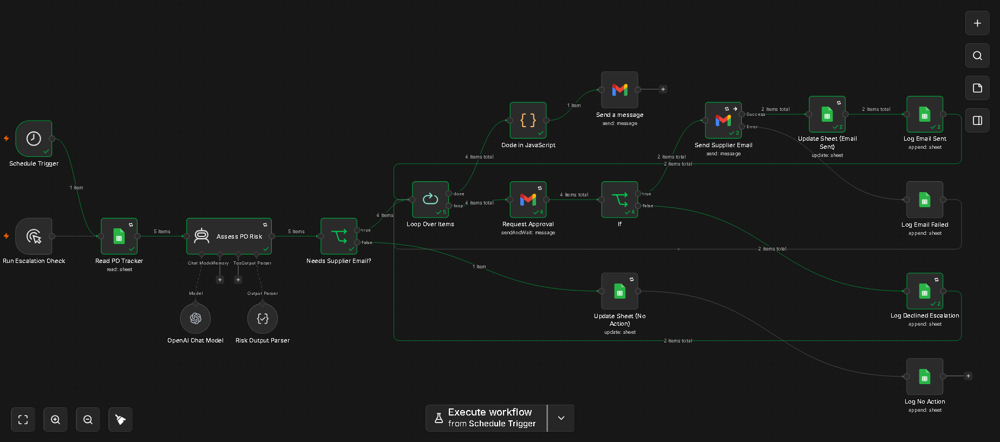

# 🌐 Supply Chain AI Control Tower

> **Autonomous multi-tier supply chain orchestration platform featuring 8 live dashboards, 11 n8n automation pipelines, Google Sheets live databases, and Gemini AI narrative intelligence.**

---

## 🏗️ Architecture

```
Frontend (Render Static Site)
├── Control Tower Navigation Hub (index.html)
├── Daily Operations Brief (digest.html)
├── Escalation Console (escalation.html)
├── Supplier Scorecard (scorecard.html)
├── Quality Incident Tracker (quality.html)
├── Freight & Shipment Tracker (freight.html)
├── Contract & SLA Manager (contracts.html)
├── Procurement Spend Tracker (spend.html)
└── Customer Order Fulfillment (fulfillment.html)
      │
      ▼ (REST Webhook Calls)
n8n Automation Engine (Render Web Service + Supabase PostgreSQL)
├── 11 Orchestrated Workflows
      │
      ├── Google Sheets API (Live Operational DB)
      └── Google Gemini AI (Narratives, Root Cause, SLA Risk)
```

---


## 🤖 n8n Workflow Automation Pipeline

The core PO automation orchestrates data ingestion from Google Sheets, the 6-criteria risk scoring engine, and automated email escalation with human-in-the-loop approvals:



### Key Orchestrated Pipeline Stages:
1. **Daily Cron Trigger & Sheets Ingestion**: Fires on an 08:00 AM daily schedule (or webhook) and pulls 19 operational columns from the Google Sheets database.
2. **6-Criteria Operational Scoring Engine**: Evaluates each PO against 6 standardized operational benchmarks:
   - 📅 **Overdue Delivery Date**: `Expected_Date < Current_Date`
   - 📦 **Pending ASN**: `ASN_Status == 'Pending'`
   - ⏱️ **Critical Inventory Runway**: `Inventory_Days < 2.0 days`
   - 📉 **Historical OTD Shortfall**: `Supplier_OTD < 85.0%`
   - 📊 **Fill Rate Shortfall**: `Fill_Rate < 90.0%`
   - ⚠️ **High Material Criticality**: `Material_Criticality == 'High'`
3. **Decision Branching (IF Node)**: Bypasses compliant suppliers (score 0–1) to auto-pass audit logging, while routing at-risk orders (score 4+ or critical runway + ASN) to the remediation flow.
4. **AI & Dynamic Email Escalation**: Auto-drafts targeted escalation emails citing specific runway deficits and unfulfilled quantities, dispatches via Gmail, and records immutable audit logs in `Execution_Log`.

---

## 📦 Project Structure

```
├── public/                 # Static web application files (Render publish directory)
│   ├── index.html          # Control Tower Hub
│   ├── config.js           # Environment-aware n8n endpoint configuration
│   ├── digest.html         # Executive daily operations briefing
│   ├── escalation.html     # PO tracking & automated tier escalation
│   ├── scorecard.html      # Supplier performance grading & radar charts
│   ├── quality.html        # Defect tracking & AI root cause analysis
│   ├── freight.html        # Carrier performance & delay alerts
│   ├── contracts.html      # Contract lifecycle & 30-day expiry radar
│   ├── spend.html          # Budget variance & category breakdown
│   └── fulfillment.html    # Order funnel pipeline & OTIF metrics
├── workflows/              # 11 production-ready n8n workflow exports
│   ├── Contracts_Workflow.json
│   ├── Digest_Workflow.json
│   ├── Freight_Workflow.json
│   ├── Fulfillment_Workflow.json
│   ├── PO Automation - Approve Webhook.json
│   ├── PO Automation - Dashboard API.json
│   ├── PO Automation - Error Handler.json
│   ├── PO Automation.json
│   ├── Quality_Workflow.json
│   ├── Scorecard_Workflow.json
│   └── Spend_Workflow.json
└── docs/                   # Setup guides and diagrams
```

---

## 🚀 Deployment Instructions

### 1. n8n Engine (Render Web Service)
1. Deploy Docker image `n8nio/n8n:latest` on Render (Free tier).
2. Connect to a free **Supabase PostgreSQL** instance (`DB_TYPE=postgresdb`).
3. Set `N8N_ENCRYPTION_KEY`, `WEBHOOK_URL`, and timezone.
4. Import the 11 workflow JSONs from `/workflows`.

### 2. Frontend Dashboards (Render Static Site)
1. Link this repository to Render as a **Static Site**.
2. Set **Publish Directory** to `public`.
3. Set your n8n production URL in `public/config.js`.

### 3. Keep-Alive (UptimeRobot)
1. Add an HTTP monitor in [UptimeRobot](https://uptimerobot.com) pointing to `https://your-n8n-app.onrender.com/healthz` every 5 minutes to prevent idle sleep.

---

## 👨‍💻 Author
**Anshul Silhare**  
Supply Chain AI Engineering & Automation  
[GitHub](https://github.com/AnshulSilhare) • [LinkedIn](https://www.linkedin.com/in/anshulsilhare)
